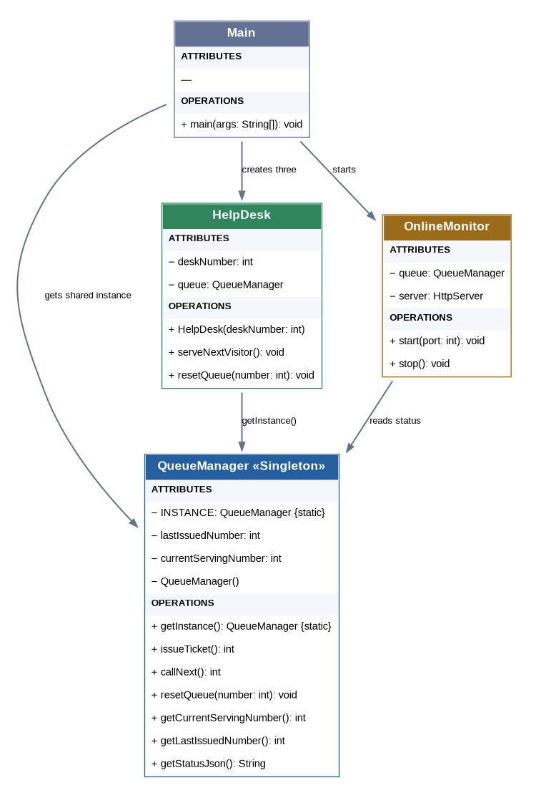
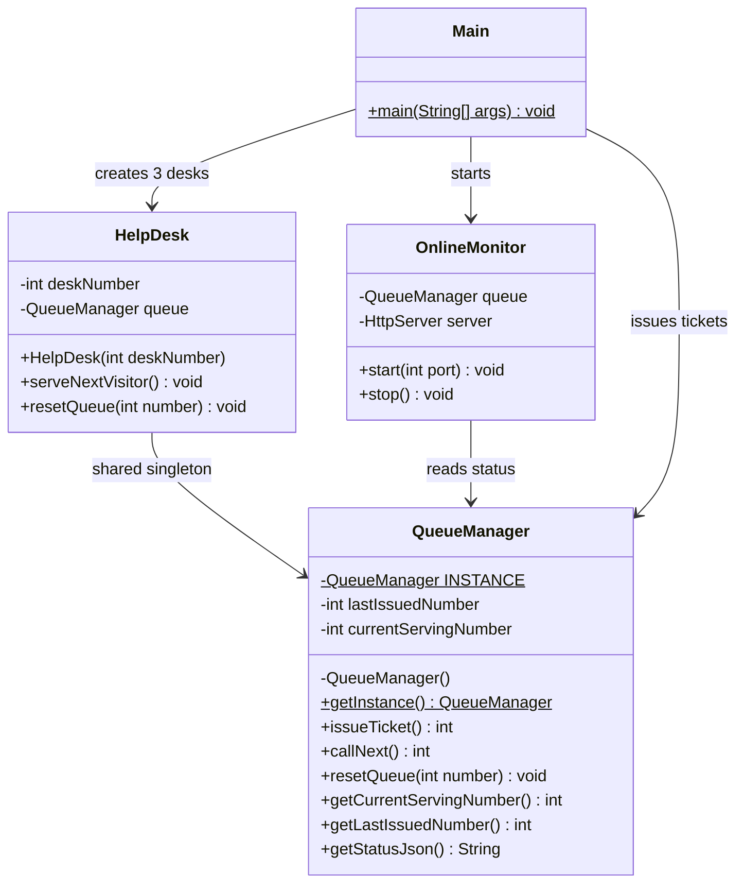

# Pag-IBIG Centralized Queuing System

**Lab Assignment 5 – Singleton Pattern**  
**Language:** Java 17+ (works with Java 23)  
**Design Pattern:** Singleton

## Problem Statement

The Pag-ibig office implements a centralized queuing system for three help desk stations. Individuals visiting the office obtain a queue number from this centralized system. Additionally, there's an online monitoring system that displays the current queued number in real-time for individuals monitoring the queue remotely.

Each help desk station has an option to reset the queuing number based on an inputted number, allowing flexibility in managing the queue during specific situations, such as reorganization or technical issues. This queuing system ensures a single centralized queue number for all help desk stations, while the reset option offers control and adjustment in exceptional circumstances.

This approach aims to maintain an organized queuing process for individuals visiting the office and provides the flexibility to handle queue adjustments as needed.

## UML Class Diagram





## How Singleton is Applied

`QueueManager` has a **private constructor** and one `private static final` instance. `getInstance()` always returns that same object. Help Desk 1, Help Desk 2, Help Desk 3, and the monitor all access it. Synchronized methods make ticket issuing, serving, and resetting safe from concurrent calls.

## How to Run in IntelliJ IDEA

1. Create a new **Java** project (JDK 17 or later; JDK 23 is fine).
2. Create these files under `src`: `QueueManager.java`, `HelpDesk.java`, `OnlineMonitor.java`, `Main.java`.
3. Paste in the code from the matching files in this repository.
4. Right-click `Main.java` and select **Run 'Main.main()'**.
5. Choose menu options in the Run console.
6. Open **http://localhost:8080** in a browser to view the monitor; it refreshes once per second.

Or compile and run from a terminal in the repository root:

```bash
javac -d out src/*.java
java -cp out Main
```

> `localhost:8080` is available on the computer running the program. For actual monitoring from another machine, the host's network address must be reachable and port 8080 allowed. This is an educational demonstration, not a publicly hosted web app.

## What the Menu Can Do

- **Issue visitor ticket**: increments the next ticket number in the one queue.
- **Serve next**: each of the three desks can call the next waiting ticket.
- **Reset queue**: any desk can set the queue to a nonnegative number; the next new ticket will be the chosen number plus 1.
- **Display status**: shows currently serving and latest ticket issued.
- **Verify Singleton instance**: shows `true` when comparing calls to `getInstance()`.

## Example Test

1. Issue three tickets: `1`, `2`, `3`.
2. Help Desk 1 serves next: `1`.
3. Help Desk 2 serves next: `2`.
4. Reset the queue at Help Desk 3 to `10`.
5. Issue another ticket: `11`.
6. Refresh the browser monitor; it will report last issued `11` and current serving `10`.

## Files

```text
PagIBIG-Singleton-Queue/
├── README.md
├── diagrams/
│   └── uml-class-diagram.png
└── src/
    ├── QueueManager.java
    ├── HelpDesk.java
    ├── OnlineMonitor.java
    └── Main.java
```
